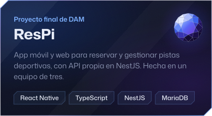
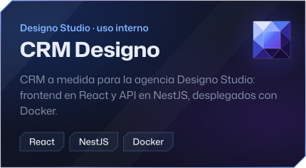
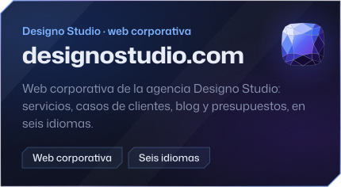
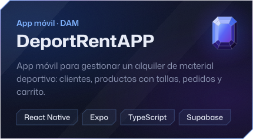
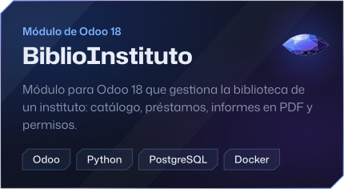
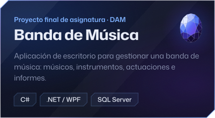
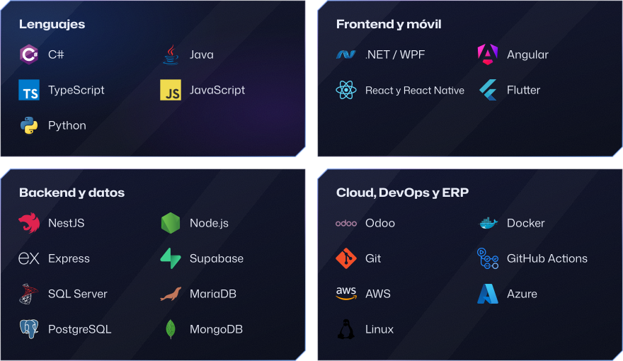
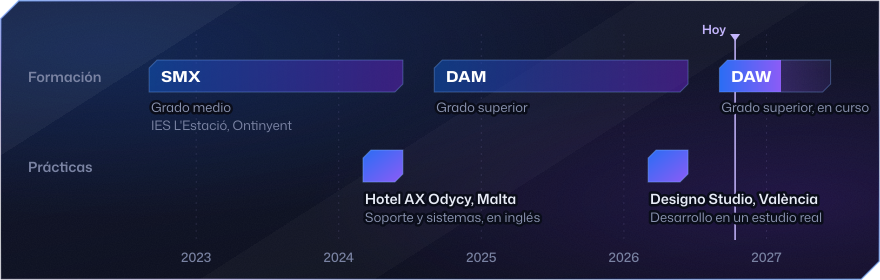

<!-- Generado desde el portfolio (Portfolio_JGT_v9): edita content/ y ejecuta "npm run readme". -->

  

<a href="https://javier-gt.dev"><strong>javier-gt.dev</strong></a> · <a href="mailto:hello@javier-gt.dev">hello@javier-gt.dev</a>

 

Hola, soy Javier. Terminé **DAM** y ahora estoy en **DAW** en el IES L'Estació de Ontinyent. Desarrollo aplicaciones completas, de escritorio, móviles y web, con sus APIs y sus bases de datos. Por mi cuenta estoy perfeccionando JavaScript y Angular, y me preparo la certificación oficial de Odoo.

Hice las prácticas de DAM en Designo Studio, donde también hicimos el CRM y la web de la agencia. Ahora busco **mi primer puesto como desarrollador junior**. Fuera del código, toco en una banda de música.

## Proyectos

  
  

  
  

  
  

## Con qué trabajo

## Trayectoria

## Actividad

  
  

<picture>
  <source media="(prefers-color-scheme: dark)" srcset="https://raw.githubusercontent.com/Yonderus/Yonderus/output/github-contribution-grid-snake-dark.svg" />
  <source media="(prefers-color-scheme: light)" srcset="https://raw.githubusercontent.com/Yonderus/Yonderus/output/github-contribution-grid-snake.svg" />
  
</picture>

## Contacto

Si quieres hablar de un puesto, de unas prácticas o de un proyecto, escríbeme a **hello@javier-gt.dev**.

